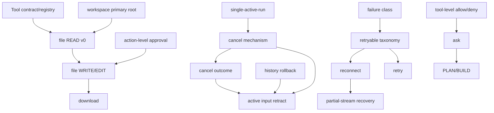

# AndroidAgent Master Capability Roadmap

Status: LIVE — the single long-lived capability plan for AndroidAgent.
Created: AG.ROADMAP-0 (2026-10-14). Normalized to Architecture v1.0:
AG.ROADMAP-0.REVIEW-1 (2026-10-14).
Stable-ID integrity repaired:
AG.ROADMAP-0.REVIEW-1A (2026-10-15). Owner: Controller.

This document answers **WHERE WE ARE GOING**: the full capability inventory,
their dependencies, their priorities, and the execution queue. It is the
roadmap SSOT. It is **not** the record of what is true now (that is
`AGENTS.md`), and it is **not** the record of what changed in one step (that is
each step doc).

**Upstream architecture basis:** `docs/AndroidAgent_Architecture_Capability_Map_v1.0.md`
(Controller-approved, FROZEN). The roadmap's canonical placement **obeys**
v1.0; the roadmap never reopens or reverse-modifies the v1.0 architecture.

---

## 1. Purpose and Scope

- One stable place for every AndroidAgent capability: what exists, what is
  planned, what is deferred, what is out of scope, what is owned by an external
  backend, and what blocks what.
- A single dependency graph (DAG) so a capability is never scheduled before its
  prerequisites are decided.
- A single execution queue (CURRENT / NEXT / LATER / DEFERRED / OUT) so the
  next step is chosen by priority + dependency + readiness, never by momentum.
- A controlled intake path so new capability ideas enter the plan before any
  step is opened.

Out of scope for this document: implementation detail, code, and the
point-in-time facts of a single step. Those belong in step docs and
`AGENTS.md`.

## 2. SSOT Relationship

```text
AGENTS.md                          = WHAT IS TRUE NOW
                                     (implemented / frozen architecture facts,
                                      verification baseline, forbidden areas)

docs/AndroidAgent_Architecture_Capability_Map_v1.0.md
                                   = WHERE CAPABILITIES BELONG
                                     (Controller-approved architecture basis;
                                      canonical placement, responsibility split)

AndroidAgent_Master_Roadmap.md     = WHERE / WHEN WE ARE GOING  (this file)
                                     (capability registry, dependencies,
                                      priority, execution queue, intake,
                                      update protocol)

docs/{research,preflight,implementation}/...
                                   = WHAT CHANGED IN THIS STEP
                                     (point-in-time evidence; never rewritten)
```

Rules:

1. The four roles are never merged. A capability's *current* status lives in
   `AGENTS.md` when implemented/frozen; its *canonical placement* lives in the
   v1.0 architecture; its *plan* lives here.
2. This roadmap is the only place that schedules capabilities. A step may only
   be opened if its capability is present in the Registry and cleared in the
   Execution Queue (or is a small bugfix under the §20 exception).
3. Historical research docs and the v1.0 architecture are point-in-time /
   frozen snapshots. They are **never edited** to match the roadmap. When the
   roadmap must record a change, the change is logged here in the Update Trail,
   not by rewriting the source.

## 3. Frozen Architecture (not reopened by this roadmap)

```text
AndroidAgent = AG Engine + Tool Layer + Host / Product

AG Engine    = AG Core + Agent Runtime
Tool Layer   = :tool-android-shell (AG.SHELL-1)
               :tool-network        (AG.NETWORK-0)
                :tool-file           (AG.FILE-0, VERIFIED)
Host/Product = AGA (Composition Root): constructs + registers concrete tools
```

Structural dependency direction (frozen):

```text
tool-* -> ag-core            ALLOWED
ag-core -> tool-*            FORBIDDEN
ag-runtime -> tool-*         FORBIDDEN
ag-core -> Android           FORBIDDEN
ag-core -> HTTP              FORBIDDEN
ag-core -> AT                FORBIDDEN
AGA -> AT implementation     FORBIDDEN
Concrete Android Tool -> Android / AT backend   ALLOWED
```

This roadmap **reopens none** of these boundaries and creates no new physical
layer or production abstraction (`:tool-layer`, ToolManager, RunControlManager,
WorkspaceManager, SandboxManager, etc. are forbidden). It only places
capabilities inside the frozen structure.

## 4. Roadmap Rules

- **Latest Evidence Wins** for a capability's *current* status; the latest step
  doc / `AGENTS.md` line supersedes older research. Historical source paths are
  preserved and cited.
- The roadmap stores **state + relations + decisions + pointers**, not a log.
  Each capability is one Registry row with stable identity.
- **No new production abstractions** are introduced by this roadmap. Names like
  RunControlManager / RecoveryManager / WorkspaceManager are *capability
  concepts*, not classes or modules. Production code is never touched by a
  roadmap step.
- Every status / priority / dependency / name / owner change is logged in the
  Update Trail (§26) with old -> new -> reason.
- **Stable capability IDs are immutable identities.** An existing ID must never
  be reassigned to a different capability. If a historically merged row is split,
  its old ID stays with one canonical child and every other child receives a new,
  previously unused ID.
- A capability has **one primary owner** (structure node) and **one canonical
  status** (pure enum). Cross-boundary capabilities (Run Control, Human
  Interaction, Sandbox, Search) are split into per-owner rows.

## 5. Status Model (frozen, pure enum)

The `Status` column may contain **only** one of these exact tokens:

| Status | Meaning |
| --- | --- |
| DISCOVERED | Named, not yet scoped |
| PLANNED | Scoped, not yet researched/preflighted |
| RESEARCH_REQUIRED | Needs a research/preflight step before it can be built |
| PREFLIGHT_READY | Preflight done, design frozen, build not started |
| IMPLEMENTATION_READY | All gates green; a build step may open immediately |
| IN_PROGRESS | A step is actively building it |
| VERIFIED | Built and verified (L1/L2/L3 as applicable) |
| CLOSED | Done; no further work expected |
| DEFERRED | Intentionally not now; named reason + re-entry condition |
| BLOCKED | Cannot proceed; named blocker |
| OUT_OF_SCOPE | Not an AndroidAgent capability (by design) |
| EXTERNAL | Owned by an external backend / OS / provider |

Decorated statuses (`VERIFIED (...)`, `OUT_OF_SCOPE (until Step)`,
`EXTERNAL (UNKNOWN)`) are forbidden in the Status column. Qualifiers go in the
Note column. Bare "TODO" is forbidden.

## 6. Priority Model (frozen)

Priority is independent of Status.

| Priority | Meaning |
| --- | --- |
| P0 FOUNDATIONAL | Foundational for the target trustworthy/mature baseline, or a prerequisite for near-term foundational capabilities. A prototype may already be usable without every P0 completed. |
| P1 REQUIRED_SOON | Required for trustworthy near-term product behavior. |
| P2 BASELINE_PARITY | A mature-agent baseline capability but not an immediate blocker. |
| P3 ENHANCEMENT | A useful improvement. |
| P4 ADVANCED | An advanced / optional capability. |

(Update Trail: P0 definition changed from "missing it, the agent is not
safe/usable at all" to "foundational for the target baseline" because the agent
already completes real work without every P0; the old definition contradicted
the actual state. Reason: accuracy, no re-ranking.)

## 7. Domain Map (v1.0-aligned canonical placement, 11 domains)

The previous 13-domain survey map is retired as a *structural* classification.
Canonical placement now follows Architecture v1.0. These are **logical
capability domains over the structural nodes** — they do **not** create
physical modules.

```text
A. AG Engine            (AG Core + Agent Runtime)   — THINK / DO-control
B. Provider             (model communication impl)  — TALK
C. Tool Layer           (concrete executable tools) — DO
D. State & Context                          — KNOW
E. Operational Environment                  — HAVE / WHERE
F. Authority & Safety                       — MAY
G. Observability & Diagnostics              — SEE
H. Extension System                         — EXTEND
I. Orchestration                            — ORCHESTRATE
J. Host / Product                           — SHOW / USER CONTROL
K. External Capability Backends / Integrations  — EXECUTE (tool -> backend)
```

Special placement rules (frozen by v1.0, recorded here):

- **Run Control is NOT a domain.** It is a *distributed capability family*:
  outcome/history semantics -> AG Core; active-run mechanism/cancellation ->
  Agent Runtime; budgets/execution-mode -> Authority; request timeout ->
  Provider; stop/background controls -> Host. Each is a row in its true owner.
- **Search is a composite capability** (Search Strategy + Search Backend), not
  a Network-Tool sub-item. It is not presupposed to be a Tool or a Skill.
- **Artifact is NOT a first-class domain.** Run outputs are resource references
  in State & Context; the file body stays in Workspace / File.
- **"Knowledge Extension" is retired** as a domain name. Memory -> State &
  Context; RAG -> composite retrieval capability (no first-class Knowledge
  subsystem); Skills/MCP/Plugins/Hooks -> Extension System.
- **Human Interaction is cross-boundary**: Core semantic + Runtime
  continuation + Host UI. It is not a Tool by default.

## 8. A. AG Engine (AG Core + Agent Runtime)

| ID | Capability | Owner (node) | Status | Priority | Requires | Blocked By | Enables | Evidence / Note |
| --- | --- | --- | --- | --- | --- | --- | --- | --- |
| CORE-001 | Agent loop (model/tool, serial) | AG Core | CLOSED | P0 | - | - | CORE-002 | AG.0 frozen; AgentCore.driveLoop |
| CORE-002 | Step budget (maxSteps semantic enforcement) | AG Core | CLOSED | P0 | CORE-001 | - | - | RunOptions.maxSteps, RunFailure.MaxStepsReached (= AUTH-013) |
| CORE-003 | Tool contract + registry | AG Core | CLOSED | P0 | - | - | TOOL-001..004 | Tool.kt, ToolRegistry.kt |
| CORE-004 | ModelProvider contract (suspend) | AG Core | CLOSED | P0 | - | - | PROVIDER-001 | Model.kt |
| CORE-005 | ToolCalls carry content (prose+tools same turn) | AG Core | CLOSED | P1 | CORE-001 | - | OBS-002 | ModelTurn.ToolCalls.content |
| CORE-006 | Tool-level approval contract seam (Allow/Deny) | AG Core | VERIFIED | P0 | CORE-003 | - | AUTH-001 | ToolApproval.kt, AllowAll |
| RUN-001 | Single active run per session | AG Core+Runtime | CLOSED | P0 | CORE-001 | - | RUN-003 | Session.tryBeginRun; AgentRuntime.runActive |
| RUN-002 | Run outcome model (Answer/Failure) | AG Core | CLOSED | P0 | CORE-001 | - | RUN-004 | RunOutcome.kt (4 failure kinds) |
| RUN-003 | Active Run cancellation mechanism | Agent Runtime | VERIFIED | P1 | RUN-001 | - | RUN-004, HOST-005 | AG.RUN-CONTROL-1.DETERMINISTIC built; Controller Review found the cooperative-flag tests did not verify the production Stop -> execution Job path; AG.RUN-CONTROL-1.DETERMINISTIC.FIX resolved it: AgentRuntime owns a REAL structured execution-child Job (kotlinx-coroutines added to :ag-runtime production); interruptActiveRun() atomically claims USER metadata and calls executionJob.cancel(); coroutine cancellation propagates naturally Core -> Provider/Tool -> Transport; reflective Job read removed; L1 I1-I15 + M1-M3 + R1-R8 + L2-FULL PASS |
| RUN-004 | Cancellation outcome + session-reusable-after-cancel semantics | AG Core | VERIFIED | P1 | RUN-003 | - | STATE-001, OBS-011 | AG.RUN-CONTROL-1.DETERMINISTIC built (semantics retained: RunOutcome.Interrupted not a Failure; exactly one RunFinished(Interrupted) via per-Run terminal latch; per-Run user-interrupt metadata; synthetic ToolResult IN_FLIGHT vs NOT_EXECUTED; session reusable); AG.RUN-CONTROL-1.DETERMINISTIC.FIX re-verified the Interrupted finalization under REAL coroutine cancellation (Job.cancel), moved condition C to per-Run ActiveRunControl state (AgentCore.lastRunOutcome removed), RunInterruptSignal reduced to semantic metadata (ensureNotInterrupted removed, onInterruptedFinalized callback added); PASS |
| CORE-007 | History rollback semantics (truncate/rollback latest run) | AG Core | RESEARCH_REQUIRED | P1 | CORE-001 | - | STATE-001, STATE-007 | Session is append-only; no remove/truncate/rollback API |
| CORE-008 | Human Interaction semantics (need-for-user-input) | AG Core | RESEARCH_REQUIRED | P1 | CORE-001 | representation NOT frozen (Tool vs ModelTurn vs Continuation) | COMP-004, HOST-009 | v1.0 placement frozen; representation = later Preflight |
| CORE-009 | Doom-loop / stuck-run detection semantics | AG Core | DISCOVERED | P2 | CORE-001 | - | - | Core/Orchestration candidate; record only, not implement |
| RUN-005 | Foreground/background Run lifecycle | Agent Runtime | DISCOVERED | P2 | RUN-003 | - | RUN-006 | not started |
| RUN-006 | Background Run | Agent Runtime | DISCOVERED | P2 | RUN-005 | Host background support | HOST-012 | not started |

## 9. B. Provider

| ID | Capability | Owner (node) | Status | Priority | Requires | Blocked By | Enables | Evidence / Note |
| --- | --- | --- | --- | --- | --- | --- | --- | --- |
| PROVIDER-001 | OpenAI-compatible streaming provider | Provider | VERIFIED | P0 | CORE-004 | - | PROVIDER-006 | OpenAiCompatibleProvider, streaming |
| PROVIDER-002 | Failure classification (Timeout/Network/HttpStatus) | Provider | VERIFIED | P1 | PROVIDER-001 | - | PROVIDER-006 | OpenAiProviderException mapping |
| PROVIDER-003 | Disconnect detection + reconnect | Provider | RESEARCH_REQUIRED | P1 | PROVIDER-006 | retryable taxonomy freeze | - | historical PROVIDER-003 identity preserved; distinct from retry and partial-stream recovery |
| PROVIDER-004 | Bounded retry / backoff | Provider | RESEARCH_REQUIRED | P1 | PROVIDER-006 | retryable-classification freeze | - | historical PROVIDER-004 identity preserved; distinct from reconnect |
| PROVIDER-005 | Partial-stream recovery | Provider | BLOCKED | P1 | PROVIDER-003 | independent design gate: network reconnect != safe turn recovery | - | historical PROVIDER-005 identity preserved; mid-stream IOException -> exception; fired deltas unrecoverable |
| PROVIDER-006 | Retryable taxonomy (which failures are retryable) | Provider | RESEARCH_REQUIRED | P1 | PROVIDER-002 | taxonomy freeze | PROVIDER-003, PROVIDER-004 | new capability; 429/Retry-After, 5xx, TCP reset, TLS EOF, partial-stream classification |
| PROVIDER-007 | Model fallback | Provider | DISCOVERED | P3 | PROVIDER-001 | - | - | not started |
| PROVIDER-008 | Provider routing | Provider | DEFERRED | P3 | PROVIDER-001 | - | - | requires explicit Step |
| PROVIDER-009 | Provider request timeout (configurable transport) | Provider | VERIFIED | P1 | PROVIDER-001 | - | - | config.requestTimeout; AndroidOpenAiHttpTransport |
| PROVIDER-010 | Provider usage metadata (token/cost data) | Provider | DISCOVERED | P2 | PROVIDER-001 | - | AUTH-015, OBS-005, OBS-006 | no token accounting today |
| PROVIDER-011 | Prompt / provider cache integration | Provider | DISCOVERED | P4 | PROVIDER-001 | - | - | not started |
| PROVIDER-012 | Provider health signal | Provider | DISCOVERED | P3 | PROVIDER-001 | - | OBS-008 | distinct from Obs health presentation |

## 10. C. Tool Layer

| ID | Capability | Owner (node) | Status | Priority | Requires | Blocked By | Enables | Evidence / Note |
| --- | --- | --- | --- | --- | --- | --- | --- | --- |
| TOOL-001 | android_shell (AT Engine Handoff) | :tool-android-shell | VERIFIED | P0 | CORE-003 | - | - | AG.SHELL-1, S1-S5 PASS; backend -> AT Engine (EXTERNAL) |
| TOOL-002 | network.fetch (HTTPS, public-network + SSRF-guarded, bounded) | :tool-network | VERIFIED | P0 | CORE-003 | - | NET-003 | AG.NETWORK-0, L1 78 + L2 + L3; backend -> Android Network Stack |
| TOOL-003 | Direct Tool Validation (tool_invoke, no LLM) | AGA | VERIFIED | P1 | CORE-003 | - | TOOL-004, NET-003 | DebugBridge.handleToolInvoke |
| TOOL-004 | file READ v0 (read/search/list/stat) | :tool-file | VERIFIED | P0 | CORE-003, ENV-001 | NONE | TOOL-005, NET-004 | AG.FILE-0, L1 55 + L2 16/16 + L3 E2E PASS; backend -> App Filesystem (NIO.2) |
| TOOL-005 | file WRITE/EDIT | :tool-file | DEFERRED | P1 | TOOL-004, AUTH-002 | mutating authority granularity (action-level approval or write-confirmation) | NET-004 | tool-level Allow + AllowAll too coarse for mutating action |
| TOOL-006 | Tool output bounding (all tools, enforcement) | Tool / Backend | DISCOVERED | P0 | CORE-003 | - | long-loop safety | RESEARCH-2 FOUNDATIONAL; enforcement owner = Tool/Backend (NOT Observability); network already bounded, shell output not |
| TOOL-008 | structured multi-file patch tool | :tool-file | DEFERRED | P3 | TOOL-005 | - | - | Codex apply-patch reference; record only |
| TOOL-009 | LSP / code intelligence tool | Tool Layer | DEFERRED | P4 | - | - | - | v1.0 enhancement candidate |
| TOOL-010 | formatter integration tool | Tool Layer | DEFERRED | P4 | - | - | - | v1.0 enhancement candidate |
| TOOL-011 | file watcher tool | Tool Layer | DEFERRED | P4 | - | - | - | v1.0 enhancement candidate |
| TOOL-012 | multimodal / image attachment normalization | Tool Layer | DEFERRED | P3 | - | no multimodal input path | - | OpenCode image-normalization reference |
| TOOL-013 | browser automation / JS tool | Tool Layer | OUT_OF_SCOPE | P4 | - | - | - | RESEARCH-3; outsized risk, not a baseline capability |
| TOOL-014 | Accessibility structured tool | Tool Layer | DEFERRED | P3 | - | - | - | v1.0 enhancement candidate |
| TOOL-015 | Android Framework structured tool | Tool Layer | DEFERRED | P3 | - | - | - | v1.0 enhancement candidate |
| TOOL-016 | Media / Sensor capability | Tool Layer | DEFERRED | P4 | - | - | - | v1.0 enhancement candidate |
| TOOL-007 | AGENT-0.CONTRAST (model tool-choice contrast) | AG | DISCOVERED | P2 | TOOL-001, TOOL-002 | - | - | evaluation step; flagged by AGENT-0.LIVE / OBSERVABILITY-0 |

## 11. D. State & Context

| ID | Capability | Owner (node) | Status | Priority | Requires | Blocked By | Enables | Evidence / Note |
| --- | --- | --- | --- | --- | --- | --- | --- | --- |
| STATE-001 | Active Input Retract (cancel run + rollback latest user turn + restore input) | State + Core + Runtime + Host | RESEARCH_REQUIRED | P1 | RUN-003, RUN-004, CORE-007 | Session append-only; Host mutates UI before send | - | composite: Runtime cancel + Core history rollback + Host input restore |
| STATE-002 | Completed Conversation Rewind | State | DISCOVERED | P3 | - | - | - | RELATED to STATE-001 (shared rollback semantics), NOT a hard dependency |
| STATE-003 | Session Persistence | State | DISCOVERED | P2 | CORE-001 | - | STATE-006 | Session in-memory only; storage model NOT frozen |
| STATE-006 | Session Resume | State + Host | DISCOVERED | P2 | STATE-003 | - | - | split from historical STATE-003 persistence/resume; new ID for Resume |
| STATE-004 | Context Compaction | State / Context | DISCOVERED | P0 | CORE-001 | - | long-session viability | historical STATE-004 identity preserved; foundational; algorithm NOT frozen |
| STATE-007 | Tool-result Pruning | State / Context | DISCOVERED | P2 | CORE-001 | - | - | keep tool-call/result pairs intact |
| STATE-008 | Context Summary | State / Context | DISCOVERED | P3 | STATE-004 | - | - | not started |
| STATE-009 | Context Pressure / Usage (semantic) | State + Observability | DISCOVERED | P2 | PROVIDER-010 | - | OBS-007 | semantic state; Obs reports it |
| STATE-010 | Persistent Memory | State | DISCOVERED | P2 | - | - | - | moved from old "Knowledge Extension"; not a first-class subsystem |
| STATE-011 | Task / Progress State (data) | State | DISCOVERED | P2 | - | - | - | data state; planning LOGIC lives in Orchestration (ORCH-002) |
| STATE-012 | External Resource / Run Output Reference | State | DISCOVERED | P2 | CORE-001 | - | - | Artifact is a reference here; file body stays in Workspace/File |
| STATE-013 | Session Serialization / Share-Export Data | State + Host | DISCOVERED | P3 | STATE-003 | - | - | Host exposes UX; State owns the data |
| STATE-005 | Session Fork | State | DISCOVERED | P4 | STATE-003 | - | - | canonical child retained from historical STATE-005 fork/checkpoint |
| STATE-014 | Checkpoint | State | DISCOVERED | P4 | STATE-003 | - | - | split from historical STATE-005 fork/checkpoint; storage NOT frozen |
| STATE-015 | Resource / File Undo | State + Tool / Workspace | DISCOVERED | P3 | TOOL-005 | - | - | code/file rollback, distinct from Conversation Rewind |

## 12. E. Operational Environment

Grant / Realm / Principal are three distinct concepts (v1.0): Grant = what
resource capability is granted; Realm = where the operation executes; Principal
= whose identity executes. Authority consumes them. Do not call all of
APP_SELF / SAF / ADB_SHELL / RUN_AS_APP a single "realm".

| ID | Capability | Owner (node) | Status | Priority | Requires | Blocked By | Enables | Evidence / Note |
| --- | --- | --- | --- | --- | --- | --- | --- | --- |
| ENV-001 | Workspace Primary Root (filesDir/agent/) | Operational Env | VERIFIED | P0 | - | - | TOOL-004 | AG.FILE-0; production filesDir/agent/ root verified on-device (L2/L3); no WorkspaceManager |
| ENV-002 | Workspace Additional Roots | Operational Env | DISCOVERED | P3 | ENV-001 | - | - | grant extra dirs |
| ENV-003 | Workspace CWD (current working directory) | Operational Env | DISCOVERED | P3 | ENV-001 | - | - | not started |
| ENV-004 | Workspace Identity | Operational Env | DISCOVERED | P3 | ENV-001 | - | - | not started |
| ENV-005 | Resource Scope | Operational Env | DISCOVERED | P2 | ENV-001 | - | - | what resources are in scope |
| ENV-006 | Resource Grant (added-dir / SAF URI capability) | Operational Env | DISCOVERED | P2 | ENV-005 | - | AUTH-001 | SAF URI = a Grant, not a Realm; SAF support itself DEFERRED (F-REALM) |
| ENV-007 | Execution Realm (APP / AT-ADB / future run-as) | Operational Env | DISCOVERED | P2 | - | - | - | where the operation executes |
| ENV-008 | Principal / Execution Identity (APP_SELF UID / uid=2000 shell / target UID) | Operational Env | DISCOVERED | P2 | ENV-007 | - | - | whose identity executes; input to Authority |
| ENV-009 | Workspace Trust State | Operational Env | DISCOVERED | P3 | ENV-001 | - | AUTH-012 | state of trust, distinct from the Trust *policy* (AUTH-012) |
| ENV-010 | Environment / temp / non-secret runtime values | Operational Env | DISCOVERED | P3 | - | - | - | not started |
| ENV-011 | Isolated Workspace / Worktree | Operational Env + Orchestration | DEFERRED | P4 | - | - | - | future; record only |
| F-ROOT | Workspace root (filesDir/agent/, no framework) | Operational Env | VERIFIED | P0 | - | - | TOOL-004 | alias of ENV-001; AG.FILE-0; stable ID preserved |
| F-REALM | Resource realm extension (SAF / ADB_SHELL / RUN_AS_APP) | Operational Env | DEFERRED | P2 | TOOL-004 | SAF UI + ActivityResult + grant persistence | - | SAF=Grant; ADB_SHELL/RUN_AS_APP=Principal+Realm. V0 does not block future extension; tool name/action family/Core contract stay stable where possible; future model-facing args MAY extend when a real realm requires it |
| F-TRUST | Workspace / project trust gate | Operational Env + Authority | DISCOVERED | P4 | ENV-009 | - | - | RESEARCH-1 deferred (project-shipped config) |

## 13. F. Authority & Safety

| ID | Capability | Owner (node) | Status | Priority | Requires | Blocked By | Enables | Evidence / Note |
| --- | --- | --- | --- | --- | --- | --- | --- | --- |
| AUTH-001 | Tool-level allow/deny (existing seam) | AG Core | VERIFIED | P0 | CORE-006 | - | AUTH-002, AUTH-008 | ToolApprovalPolicy.decide(call) |
| AUTH-002 | Action-level approval policy | AG Core | DISCOVERED | P1 | AUTH-001 | - | TOOL-005, AUTH-019, AUTH-020 | canonical child retained from historical AUTH-002 action-level/per-path row |
| AUTH-003 | Approval persistence | AG Core + AGA | DISCOVERED | P2 | AUTH-008 | - | AUTH-009 | canonical child retained from historical AUTH-003 approval-persistence/named-modes row |
| AUTH-004 | Public-only network destination policy | :tool-network | VERIFIED | P0 | AUTH-005 | - | AUTH-011 | canonicalized from historical AUTH-004 egress row; current truth is public-only, not per-domain |
| AUTH-005 | SSRF private/reserved-IP guard | :tool-network | VERIFIED | P0 | TOOL-002 | - | AUTH-004 | historical AUTH-005 identity preserved; PublicIpGuard v4+v6; one-way dependency avoids TOOL-002/AUTH cycle |
| AUTH-006 | Connection pinning (anti-redirect) | :tool-network | DEFERRED | P2 | AUTH-005 | - | - | historical AUTH-006 identity preserved; RESEARCH-3 deferred |
| AUTH-007 | Credential protection / mask/re-sign | :tool-network + AGA | DEFERRED | P3 | AUTH-001 | credential model absent | - | historical AUTH-007 identity preserved |
| AUTH-008 | Ask (interactive approval) | AG Core + AGA | DISCOVERED | P1 | AUTH-001 | - | AUTH-003, AUTH-009, AUTH-016, HOST-007 | allow/ask/deny; allow/deny exist, ask not built |
| AUTH-009 | Named execution modes (mode-aware default shift) | AG Core + AGA | DISCOVERED | P2 | AUTH-008 | - | AUTH-016 | split from historical AUTH-003; plan/auto-style defaults, distinct from PLAN/BUILD enforcement |
| AUTH-010 | Argument / pattern matching | AG Core | DISCOVERED | P2 | AUTH-002 | - | - | policy engine argsPattern |
| AUTH-011 | Per-host / per-domain egress policy | :tool-network | DEFERRED | P2 | AUTH-001 | - | - | distinct from AUTH-004 public-only baseline; alias relation NET-002 |
| AUTH-012 | Workspace Trust Policy | AG Core + AGA | DISCOVERED | P3 | ENV-009 | - | - | policy side of trust; state = ENV-009 |
| AUTH-013 | Run step budget policy | AG Core | CLOSED | P0 | CORE-002 | - | - | = maxSteps, already implemented |
| AUTH-014 | Run elapsed-time policy | Runtime + Authority | DISCOVERED | P2 | RUN-001 | - | - | distinct from provider request timeout PROVIDER-009 |
| AUTH-015 | Cost / budget cap | Authority + Provider + Observability | DISCOVERED | P2 | PROVIDER-010, OBS-005 | - | - | policy + usage data + accounting; no independent Budget subsystem |
| AUTH-016 | PLAN / BUILD execution mode | Authority | DISCOVERED | P1 | AUTH-008 | - | HOST-008 | enforcement = Authority policy; Host only selects/presents; Prompt != security boundary |
| AUTH-017 | Policy source / tiering (default/workspace/user/managed) | AG Core + AGA | DISCOVERED | P3 | AUTH-001 | - | - | RESEARCH-1 policy tiering |
| AUTH-018 | Protected resources / anti-self-escalation | AG Core | DISCOVERED | P3 | AUTH-001 | - | - | protect config/hook/settings from self-write |
| AUTH-019 | Path-level policy matching | AG Core | DISCOVERED | P2 | AUTH-002 | - | - | split from historical AUTH-002; per-path allow/deny |
| AUTH-020 | Side-effect-class policy | AG Core | DISCOVERED | P3 | AUTH-002 | - | - | classify by side effect |
| AUTH-021 | Sandbox semantics | Environment + Authority + Tool/Backend + OS | DISCOVERED | P2 | AUTH-001, ENV-001 | - | - | composite safety model, not a SandboxManager; OS boundary = App UID/SELinux/scoped storage |

## 14. G. Observability & Diagnostics

Output Bounding ownership (v1.0): TOOL-006 in Tool/Backend owns enforcement;
State/Context is the protected consumer; Observability owns reporting (OBS-012);
Host owns rendering. Enforcement is NOT owned by Observability.

| ID | Capability | Owner (node) | Status | Priority | Requires | Blocked By | Enables | Evidence / Note |
| --- | --- | --- | --- | --- | --- | --- | --- | --- |
| OBS-001 | Active provider truth + streaming transcript | AGA | VERIFIED | P1 | PROVIDER-001 | - | OBS-002 | AGA.OBSERVABILITY-0 |
| OBS-002 | Transcript Thinking->Thought + debug User block | AGA | CLOSED | P1 | OBS-001 | - | - | AGA.OBSERVABILITY-1 |
| OBS-003 | PC Debug Bridge (TCP JSONL, live stream) | AGA | VERIFIED | P1 | OBS-001 | - | TOOL-003 | AG.DEBUG-0 |
| OBS-004 | Agent trace (redacted replay) | AGA | VERIFIED | P2 | OBS-001 | - | - | AGENT-0.PREFLIGHT |
| OBS-005 | Token accounting (reporting) | Provider + Observability | DISCOVERED | P2 | PROVIDER-010 | - | AUTH-015 | reports token facts; data from Provider |
| OBS-006 | Cost accounting (reporting) | Observability | DISCOVERED | P2 | OBS-005 | - | AUTH-015 | reports cost facts |
| OBS-007 | Context usage / pressure (reporting) | Observability | DISCOVERED | P2 | STATE-009 | - | - | reports pressure; semantics in State |
| OBS-008 | Provider health (presentation) | Observability | DISCOVERED | P3 | PROVIDER-012 | - | - | distinct from PROVIDER-012 signal |
| OBS-009 | Tool health (presentation) | Observability | DISCOVERED | P3 | - | - | - | not started |
| OBS-010 | Retry / reconnect status (reporting) | Observability | DISCOVERED | P2 | PROVIDER-004, PROVIDER-003 | - | - | reports recovery facts |
| OBS-011 | Cancellation status (reporting) | Observability | DISCOVERED | P2 | RUN-004 | - | - | reports cancel facts |
| OBS-012 | Output truncation / spill reporting | Observability | DISCOVERED | P2 | TOOL-002 | - | - | reports truncation/spill; enforcement in Tool/Backend |
| OBS-013 | Diagnostics / Doctor | Observability | DISCOVERED | P3 | - | - | - | not started |

## 15. H. Extension System

Skills/MCP/Plugins/Hooks/Custom Commands/Custom Tools/Rules are legitimate future
capabilities. "Forbidden without an explicitly opened Step" is sequencing /
governance, not OUT_OF_SCOPE. Memory is State & Context (STATE-010). Historical
EXT-002 bundled Memory/RAG; its canonical retained child is RAG, while Memory
moves to STATE-010.

| ID | Capability | Owner (node) | Status | Priority | Requires | Blocked By | Enables | Evidence / Note |
| --- | --- | --- | --- | --- | --- | --- | --- | --- |
| EXT-001 | Skills loader | Extension | DEFERRED | P3 | - | - | - | historical EXT-001 identity preserved; requires explicit Step to re-enter |
| EXT-002 | RAG (composite retrieval capability) | Extension + State | DEFERRED | P3 | STATE-010 | - | - | canonical child retained from historical EXT-002 Memory/RAG; no first-class Knowledge subsystem |
| EXT-003 | MCP (Model Context Protocol) | Extension | DEFERRED | P3 | - | - | - | new capability; requires explicit Step to re-enter |
| EXT-004 | Plugins / Extensions | Extension | DEFERRED | P3 | - | - | - | requires explicit Step to re-enter |
| EXT-005 | Hooks | Extension | DEFERRED | P3 | - | - | - | requires explicit Step to re-enter |
| EXT-006 | Custom Commands | Extension | DEFERRED | P4 | - | - | - | requires explicit Step to re-enter |
| EXT-007 | Custom Tools | Extension | DEFERRED | P4 | - | - | - | requires explicit Step to re-enter |
| EXT-008 | Rules / Instruction Sources | Extension | DEFERRED | P4 | - | - | - | requires explicit Step to re-enter |

## 16. I. Orchestration

Planning/delegation/continuation logic belongs here. Task/Progress data state
belongs to State & Context (STATE-011). Historical ORCH-001 was
"Multi-agent / sub-agents" and remains the Subagent/Multi-agent identity.

| ID | Capability | Owner (node) | Status | Priority | Requires | Blocked By | Enables | Evidence / Note |
| --- | --- | --- | --- | --- | --- | --- | --- | --- |
| ORCH-001 | Multi-agent / Subagents | Orchestration | DISCOVERED | P3 | CORE-001 | - | ORCH-004, ORCH-005, ORCH-006 | historical ORCH-001 identity preserved |
| ORCH-002 | Task Planning / Decomposition | Orchestration | DISCOVERED | P3 | CORE-001 | - | ORCH-003 | distinct from PLAN/BUILD execution mode AUTH-016 |
| ORCH-003 | Task / Semantic Progress (logic) | Orchestration | DISCOVERED | P3 | ORCH-002 | - | ORCH-010 | data state = STATE-011 |
| ORCH-004 | Delegation | Orchestration | DISCOVERED | P3 | ORCH-001 | - | ORCH-009, ORCH-011 | not started |
| ORCH-005 | Depth / Recursion Control | Orchestration | DISCOVERED | P3 | ORCH-001 | - | - | not started |
| ORCH-006 | Context Inheritance / Isolation | Orchestration | DISCOVERED | P3 | ORCH-001 | - | - | not started |
| ORCH-007 | Inter-agent Messaging | Orchestration | DISCOVERED | P4 | ORCH-001 | - | ORCH-008 | not started |
| ORCH-008 | Structured Handoff | Orchestration | DISCOVERED | P4 | ORCH-007 | - | - | not started |
| ORCH-009 | Failure-aware Continuation | Orchestration | DISCOVERED | P3 | ORCH-004 | - | - | not started |
| ORCH-010 | Evidence / Remaining Work (records) | Orchestration + State | DISCOVERED | P3 | ORCH-003 | - | - | records; State cross-reference |
| ORCH-011 | Workflow / Teams | Orchestration | DISCOVERED | P4 | ORCH-004 | - | - | not started |

## 17. J. Host / Product

Host owns SHOW / USER CONTROL / PRODUCT SURFACE. Historical HOST-004 remains
`AGC / further frontend`; new control surfaces receive new IDs.

| ID | Capability | Owner (node) | Status | Priority | Requires | Blocked By | Enables | Evidence / Note |
| --- | --- | --- | --- | --- | --- | --- | --- | --- |
| HOST-001 | AGA composition root + tool registration | AGA | VERIFIED | P0 | CORE-003 | - | TOOL-* | ChatCompositionRoot |
| HOST-002 | Provider config auto-load (provider.local.json) | AGA | VERIFIED | P1 | PROVIDER-001 | - | - | AGA.DEV-CONFIG-0 |
| HOST-003 | Host control (provider node, AT connect, status) | AGA | VERIFIED | P1 | HOST-001 | - | - | AGA.HOST-CONTROL-0 |
| HOST-004 | AGC / further frontend | Host / Product | DEFERRED | P3 | - | - | - | historical HOST-004 identity preserved; requires explicit Step to re-enter |
| HOST-005 | Stop / Cancel UI | AGA | VERIFIED | P1 | RUN-003 | - | - | AG.RUN-CONTROL-1.DETERMINISTIC built the Stop button + Interrupted transcript block (JVM-tested, T23); Controller Review of AG.HOST-STOP-1 found no REAL user-facing Stop UI/device acceptance had been verified (the prior VERIFIED proved the Host contract + Runtime backend, not the live UI surface). Re-opened by AG.HOST-STOP-1: real Stop UI (IDLE/RUNNING/INTERRUPTING host states, Stopping.../Stopped) + H1-H8 host tests + host/runtime integration + OpenAI-compatible test fixture + real-device acceptance via ADB reverse (D1-D4). D1/D2/D4 PASS on real device (dispatch-fixed build); D3 initially INCONCLUSIVE — D3 closeout identified root cause as FIXTURE SSE framing (keep-alive vs close, Case E, HIGH confidence): byte-level traces proved the fixture kept the connection open after [DONE] with no EOF; fix = fixture Connection: close; 2 deterministic JVM transport tests added; D3 re-test PASS (2.2 s natural completion, 12 tokens, no timeout). Stop smoke PASS (one clean stop, Interrupted, Stopped.). Pre-existing :app bug found and fixed: DebugBridge-originated runs did not enable the UI Stop button (onRunStateChanged callback added). Regression green (ag-core 41, ag-runtime 26, provider 59, app 109). D1-D4 ALL PASS |
| HOST-006 | Retract UI | AGA | RESEARCH_REQUIRED | P1 | STATE-001 | - | - | Host input-restoration surface |
| HOST-007 | Approval / Ask UI | AGA | DISCOVERED | P2 | AUTH-008 | - | - | not started |
| HOST-008 | Execution Mode selector (PLAN / BUILD) | AGA | DISCOVERED | P2 | AUTH-016 | - | - | selector/presentation only; enforcement in Authority |
| HOST-009 | Human Interaction UI (question / choice) | AGA | RESEARCH_REQUIRED | P1 | CORE-008 | - | - | representation NOT frozen |
| HOST-010 | Session list / browser | AGA | DISCOVERED | P3 | STATE-003 | - | - | not started |
| HOST-011 | Resume / Fork / Share / Export UX | AGA | DISCOVERED | P3 | STATE-006, STATE-005, STATE-013 | - | - | not started |
| HOST-012 | Background notifications | AGA | DISCOVERED | P3 | RUN-006 | - | - | not started |
| HOST-013 | Context usage UI | AGA | DISCOVERED | P3 | OBS-007 | - | - | not started |
| HOST-014 | Cost / Health UI | AGA | DISCOVERED | P3 | OBS-006, OBS-008 | - | - | not started |
| HOST-015 | Headless / non-interactive Host | Host / Product | DISCOVERED | P3 | HOST-001 | - | - | not started |
| HOST-016 | Config layering / precedence | AGA | DISCOVERED | P3 | HOST-002 | - | - | storage/parse = Host; policy meaning = Authority |
| HOST-017 | Managed / Admin config | AGA | DISCOVERED | P4 | HOST-016 | - | - | not started |
| HOST-018 | Server / SDK / API surface | Host / Product | DEFERRED | P4 | - | - | - | requires explicit Step to re-enter |
| HOST-019 | IDE / Web / Remote surfaces | Host / Product | DEFERRED | P4 | - | - | - | requires explicit Step to re-enter |
| HOST-020 | Output Style / Persona | AGA | DISCOVERED | P3 | HOST-001 | - | - | Host config; may affect prompt/rendering; not a Tool |

## 18. K. External Capability Backends / Integrations

Owned outside AndroidAgent. Historical AT-001..004 identities are preserved.
Additional non-AT backends use EXT-BK-* IDs.

| ID | Capability | Owner (node) | Status | Priority | Requires | Blocked By | Enables | Evidence / Note |
| --- | --- | --- | --- | --- | --- | --- | --- | --- |
| AT-001 | ADB pairing / discovery / transport / reconnect | AT | EXTERNAL | - | - | - | - | historical AT-001 identity preserved; ADB pairing / identity / TLS-CNXN / discovery / connectAuto / transport / transport-loss observation / bounded recovery are ALL owned by the AT external ADB subsystem; AG does not duplicate any of it (verified: ADB_RESPONSIBILITY_DUPLICATED_IN_AG = NO); AG integrates via Handoff only |
| AT-002 | Terminal PTY / shell execution transport / principal | AT | EXTERNAL | - | - | - | - | historical AT-002 identity preserved; Handoff V1 external AT truth: one-shot execution, persistent raw terminal, raw byte IO, Ctrl-C, resize, lifecycle/close, Local + ADB backends, multi-session, transport-loss semantics (PERSISTENT_EXECUTION_CAPABILITY = MATURE_ENOUGH_FOR_EMULATOR); AG current consumer = ONE-SHOT ONLY (AtRuntime.execute); external capability availability != AG implementation |
| AT-003 | Shell-side network reachability | AT | EXTERNAL | - | - | AT must verify independently | - | historical AT-003 identity preserved; current reachability UNKNOWN; untrusted side-channel |
| AT-004 | Android in-app egress proxy (VpnService) | Host / Product | OUT_OF_SCOPE | P4 | - | platform asymmetry | - | historical AT-004 identity preserved; too heavy, in-app policy is the ceiling |
| EXT-BK-001 | Android Framework / OS | OS | EXTERNAL | - | - | - | - | platform substrate |
| EXT-BK-002 | App Filesystem / SAF backend | OS | EXTERNAL | - | - | - | - | backend for :tool-file |
| EXT-BK-003 | Android Network Stack | OS | EXTERNAL | - | - | - | - | backend for :tool-network |
| EXT-BK-004 | Provider-hosted search backend | Provider-hosted | EXTERNAL | - | - | - | - | provider-side search, if ever used |

## 19. Composite / Cross-boundary Capabilities (not a first-class domain)

These span structure nodes. They are recorded as composite identities; each part
is owned by the rows above. They do NOT create a new module or subsystem.

| ID | Capability | Composition | Status | Priority | Note |
| --- | --- | --- | --- | --- | --- |
| COMP-001 | Search | Search Strategy (Skill / Agent reasoning / Orchestration) + Search Backend (provider-hosted EXT-BK-004 / concrete Tool / external) | DISCOVERED | P3 | NOT presupposed to be a Tool or a Skill. Provider-hosted and agent-side are ALTERNATIVES, not a hard chain. |
| COMP-002 | Research | Search (COMP-001) + Fetch (TOOL-002) + Reasoning + Evidence | DISCOVERED | P3 | composite workflow; no research_tool |
| COMP-003 | Download | Fetch (TOOL-002) + File Write (TOOL-005) + Workspace Scope (ENV-001) + Authority | DEFERRED | P3 | = old NET-004; not a new network primitive; needs file WRITE |
| COMP-004 | Human Interaction | Core semantic (CORE-008) + Runtime continuation + Host UI (HOST-009) | RESEARCH_REQUIRED | P1 | Agent->Human->Agent; distinct from Stop/Cancel (Runtime Control). Representation NOT frozen. |
| COMP-005 | Artifact / Run Output | State reference (STATE-012) + Workspace/File body | DISCOVERED | P2 | not a first-class layer, not a default Tool |
| COMP-006 | Run Control (family) | Core (RUN-004) + Runtime (RUN-003/005/006) + Authority (AUTH-014/012/013) + Provider (PROVIDER-009) + Host (HOST-005) | RESEARCH_REQUIRED | P1 | distributed capability family; NOT a physical RunControlManager |
| COMP-007 | Sandbox | Environment (ENV-*) + Authority (AUTH-021) + Tool/Backend enforcement + Android OS boundary | DISCOVERED | P2 | composite safety model; not a SandboxManager |

### Network tail (composite/deferred, kept for continuity)

| ID | Capability | Status | Priority | Requires | Note |
| --- | --- | --- | --- | --- | --- |
| NET-001 | Provider-side hosted search backend | EXTERNAL | - | - | = EXT-BK-004; provider-owned |
| NET-002 | Per-host / per-domain allow/deny policy | DEFERRED | P2 | AUTH-001 | = AUTH-011 (kept ID for continuity) |
| NET-003 | Agent-side search backend (concrete Tool option) | DISCOVERED | P3 | - | ALTERNATIVE to NET-001, NOT a hard dependency on it; part of COMP-001 |
| NET-004 | Download (materialize to file) | DEFERRED | P3 | TOOL-005, TOOL-002 | = COMP-003 (kept ID for continuity) |
| NET-005 | HTTP POST / auth / cookies / raw socket | OUT_OF_SCOPE | P4 | - | RESEARCH-3; outsized risk |
| NET-006 | Browser automation / JS | OUT_OF_SCOPE | P4 | - | = TOOL-013 |
| NET-007 | PDF / image fetch into context | DEFERRED | P4 | - | no multimodal path; = TOOL-012 |

## 20. Roadmap-First Development Discipline (frozen)

A new capability must enter the Roadmap before a Step opens it:

```text
Intake -> Registry lookup -> Domain/Owner classification -> dependency check
       -> priority impact -> Execution Queue decision -> Controller approval
       -> then open the Step
```

Exception: a small, clearly-scoped bugfix that reuses existing frozen semantics
and introduces no new capability (e.g. AGA.OBSERVABILITY-1) does not require a
Roadmap entry. Do not build a capability that is not in the Registry, and do
not reorder the Execution Queue without logging old -> new -> reason in the
Update Trail (§26).

## 21. Completed Baseline (VERIFIED / CLOSED, do not re-plan)

CORE-001..006, RUN-001, RUN-002, PROVIDER-001, PROVIDER-002, PROVIDER-009,
TOOL-001, TOOL-002, TOOL-003, TOOL-004, ENV-001, F-ROOT, OBS-001, OBS-002,
OBS-003, OBS-004, HOST-001, HOST-002, HOST-003, AUTH-001, AUTH-004, AUTH-005,
AUTH-013.

Full verification evidence remains in `AGENTS.md` Current Frozen State and the
cited historical Step docs. REVIEW-1A changes Roadmap IDs only; it does not
change implementation truth.

## 22. Dependency Graph (canonical table — HARD is the DAG source of truth)

HARD = "cannot correctly implement without it". SOFT / ENABLES = unlocks or
quality preference. RELATED = independent but adjacent. ALTERNATIVE = a choice,
not a prerequisite. The HARD edges form a DAG; REVIEW-1A re-validates after
Stable-ID restoration.

| Capability | HARD Requires | SOFT / Enables | RELATED / ALTERNATIVE |
| --- | --- | --- | --- |
| TOOL-004 (file READ) | CORE-003, ENV-001 | Enables TOOL-005, COMP-003 | TOOL-002 |
| TOOL-005 (file WRITE/EDIT) | TOOL-004, AUTH-002 | Enables COMP-003, TOOL-008 | - |
| TOOL-006 (output bounding) | CORE-003 | Enables long-loop safety | network.fetch already bounded |
| COMP-003 / NET-004 (download) | TOOL-005, TOOL-002 | - | - |
| AUTH-005 (SSRF guard) | TOOL-002 | Enables AUTH-004 | one-way; TOOL-002 does NOT require AUTH-005 |
| AUTH-004 (public-only policy) | AUTH-005 | - | verified with TOOL-002 |
| RUN-003 (cancel mechanism) | RUN-001 | Enables RUN-004, HOST-005 | - |
| RUN-004 (cancel outcome) | RUN-003 | Enables STATE-001, OBS-011 | - |
| CORE-007 (history rollback) | CORE-001 | Enables STATE-001 | - |
| STATE-001 (retract) | RUN-003, RUN-004, CORE-007 | - | RELATED STATE-002 |
| STATE-002 (rewind) | - | - | RELATED STATE-001; NOT a hard dependency |
| STATE-015 (resource/file undo) | TOOL-005 | - | RELATED STATE-002 |
| STATE-006 (resume) | STATE-003 | - | - |
| STATE-005/014 (fork/checkpoint) | STATE-003 | - | - |
| STATE-004 (compaction) | CORE-001 | - | - |
| PROVIDER-006 (retryable taxonomy) | PROVIDER-002 | Enables PROVIDER-003, PROVIDER-004 | - |
| PROVIDER-003 (disconnect/reconnect) | PROVIDER-006 | - | distinct from retry |
| PROVIDER-004 (retry) | PROVIDER-006 | - | distinct from reconnect |
| PROVIDER-005 (partial-stream recovery) | PROVIDER-003 | - | own design gate |
| AUTH-002 (action-level) | AUTH-001 | Enables TOOL-005, AUTH-019, AUTH-020 | - |
| AUTH-008 (ask) | AUTH-001 | Enables AUTH-003, AUTH-009, AUTH-016, HOST-007 | - |
| AUTH-003 (approval persistence) | AUTH-008 | - | historical split from named modes |
| AUTH-009 (named modes) | AUTH-008 | Enables AUTH-016 | - |
| AUTH-011 / NET-002 (per-host policy) | AUTH-001 | - | refinement beyond AUTH-004 |
| AUTH-016 (PLAN/BUILD) | AUTH-008 | Enables HOST-008 | distinct from ORCH-002 |
| AUTH-014 (run elapsed-time) | RUN-001 | - | distinct from PROVIDER-009 |
| AUTH-015 (cost cap) | PROVIDER-010, OBS-005 | - | - |
| COMP-001 (search) | - | - | BACKENDS ALTERNATIVE: NET-001, NET-003 |
| COMP-002 (research) | COMP-001, TOOL-002 | - | - |
| COMP-004 (human interaction) | CORE-008 | Enables HOST-009 | distinct from RUN-003 |
| ORCH-001 (subagents/multi-agent) | CORE-001 | Enables ORCH-004/005/006 | - |

Major hard-dependency chain (Mermaid, illustrative — the table above is the
source of truth):



## 23. Implementation Gates (per open capability)

- **TOOL-004 (file READ v0)**: SATISFIED. AG.FILE-0.PREFLIGHT -> AG.FILE-0 build
  step -> VERIFIED (L1 55 + L2 16/16 + L3 E2E PASS). No longer an open gate.
- **RUN-003/004 (cancel)**: Gate SATISFIED by `AG.RUN-CONTROL-0.PREFLIGHT` +
  `.CLOSEOUT` (+ FINAL C1 correction) (frozen: interrupt ownership = Runtime with an
  ATOMIC handle that cancels the structured execution child only; the child
  terminates CANCELLED and the still-active send caller converts THIS USER child
  cancel to Host-visible RunOutcome.Interrupted — a lifecycle-cancelled caller
  propagates, never converted; propagation via existing suspend chain, no Provider
  change; transport already cancel-safe; terminal event = reuse RunFinished;
  per-Run user-interrupt metadata carried into Core (Core never queries Runtime);
  history-on-interrupt pairing via synthetic T that distinguishes in-flight
  (external state may be unknown) vs not-executed; session reusable when the Run
  coroutine reaches terminal). NEXT = a small build step (Runtime mechanism + Core
  semantics + Host Stop UI + L1/L2 deterministic verification incl. I11-I15).
  CORE-007 arbitrary rollback remains RESEARCH_REQUIRED (only the history-on-
  interrupt slice was frozen).
- **STATE-001 (retract)**: Gate = RUN-003/004 + CORE-007 (Core rollback seam) +
  HOST-006 (Host input restore). RESEARCH_REQUIRED.
- **PROVIDER-006/003/004/005 (recovery)**: Gate = a retryable-taxonomy preflight.
  PROVIDER-005 additionally needs its own partial-stream design gate.
- **AUTH-002 (action-level approval)**: Gate = a preflight extending
  `ToolApprovalPolicy.decide` from tool-level to (tool, action) without breaking
  AllowAll. Unblocks TOOL-005.
- **TOOL-006 (output bounding)**: Gate = a small preflight defining the shared
  bound seam (char cap / spill); enforcement in Tool/Backend, reporting in
  Observability.
- **STATE-004 (compaction)**: Gate = a research step (unit, timing, how to keep
  tool-call/result pairs intact). P0, not yet scoped.
- **COMP-004 / HOST-009 (human interaction)**: Gate = a preflight to choose the
  representation (ask_user Tool vs ModelTurn.NeedUserInput vs Continuation).

## 24. Execution Queue (recomputed, not copied from the prior roadmap)

Recomputed from Registry + dependency + priority + readiness + architecture
risk after the v1.0 normalization. **CURRENT is NONE** immediately after
AG.ROADMAP-0.REVIEW-1A closes (this repair is documentation-only).

### CURRENT
- NONE. AG.V2-1.BASELINE-MIGRATION = CLOSED by the V2 baseline commit (tag
  AG.V2-BASELINE-V1). AndroidAgent-V2 is now the ACTIVE DEVELOPMENT TREE with a
  VERIFIED baseline equivalent to the V1 freeze. V1 remains FROZEN_KNOWN_GOOD:
  reference / rollback / evidence source; NO new feature development on V1.

### NEXT (<=5, in recommended order)
Recomputed after AG.V2-1.BASELINE-MIGRATION (V2 baseline established from the
frozen V1; production equivalence verified). Frozen migration sequence:
AG.V2-2.AT-INTEGRATION -> NEW AT INTEGRATION GATE ->
AG.OUTPUT-BOUND.PREFLIGHT -> future capabilities on V2.
TOOL-006 status/priority/identity UNCHANGED; only execution order changes
(TOOL_006_TARGET = V2). NEXT_OPEN_AUTHORIZED = NO (awaiting Controller Review
of the V2 baseline evidence).

 1. **AG.V2-2.AT-INTEGRATION** — (migration sequence step).
    New AT integration (Handoff V2 / post-emulator) on V2 only: new AT binary /
    handoff bundle, tool-android-shell compatibility, AT provenance refresh,
    one-shot regression. NO persistent-terminal tool in this step (that needs
    capability intake + preflight + TOOL-006 + AT contract stabilization).
 2. **AG.OUTPUT-BOUND.PREFLIGHT** — TOOL-006.
    Status DISCOVERED; P0; hard prereq CORE-003 (satisfied); blocker none; risk
    LOW (shared seam). Why later: V1 is frozen; new feature development happens
    on V2 after the AT integration gate. Capability semantics UNCHANGED.
 3. **AG.PROVIDER-RECOVERY.PREFLIGHT** — PROVIDER-006/003/004/005.
    Status RESEARCH_REQUIRED / BLOCKED; P1; hard prereq PROVIDER-002 (satisfied);
    blocker = partial-stream design gate; risk MEDIUM (transport semantics).
    Why later: user-surfaced; freeze the retryable taxonomy + the partial-stream
    gate before any recovery code.

### LATER (queued, not next)
- STATE-001 (retract) — after RUN-CONTROL preflight + build.
- AUTH-002 (action-level approval) — after a preflight; unblocks TOOL-005.
- TOOL-005 (file WRITE/EDIT) — after AUTH-002.
- COMP-003 / NET-004 (download) — after TOOL-005 + TOOL-002.
- COMP-004 / HOST-009 (human interaction) — after a representation preflight.
- AUTH-016 (PLAN/BUILD) + HOST-008 — after an approval-policy preflight.
- STATE-003/006 (persistence/resume), OBS-005/006 (token/cost), AUTH-003/009
  (approval persistence / named modes) — P2.
- NET-002/AUTH-011 (per-host policy), AUTH-006 (pinning), F-REALM (SAF) — P2/P3.
- TOOL-007 (AGENT-0.CONTRAST) — P2, evaluation step.
- COMP-001 (search), EXT-002 (RAG), AUTH-007 (credential) — P3.

### DEFERRED (named reason + re-entry)
See §25 Deferred Registry.

### OUT_OF_SCOPE (not an AndroidAgent capability by design)
AT-004 (in-app egress proxy), NET-005 (POST/cookies/raw socket), NET-006 /
TOOL-013 (browser/JS). All other "not now" capabilities (Skills, MCP, Plugins,
Hooks, Subagents, AGC, Memory, RAG, Human Interaction) are **DEFERRED**, not
OUT_OF_SCOPE.

## 25. Deferred Registry (reason taxonomy)

| ID | Capability | Reason (taxonomy) | Re-entry condition |
| --- | --- | --- | --- |
| TOOL-005 | file WRITE/EDIT | AUTHORITY_NOT_READY | AUTH-002 action-level approval or Host write-confirmation |
| F-REALM | SAF / ADB_SHELL / RUN_AS_APP extension | DESIGN_NOT_STARTED (realm seam reserved) | SAF UI + ActivityResult + grant persistence step |
| F-TRUST | project/workspace trust gate | NOT_NEEDED_YET (no project-shipped config) | when AG loads project config |
| AUTH-007 | credential mask/re-sign | MISSING_PREREQ (no credential model) | when a credential model exists |
| AUTH-006 | connection pinning | SEQUENCING (after basic SSRF guard) | when a redirect-SSRF need is shown |
| AUTH-011/NET-002 | per-host allow/deny policy | SEQUENCING (after AUTH-004) | a network policy preflight |
| COMP-003/NET-004 | download | MISSING_PREREQ (file WRITE) | TOOL-005 done |
| NET-007 | PDF/image fetch | MISSING_PREREQ (no multimodal path) | a multimodal step |
| EXT-001 | Skills | GOVERNANCE (requires explicit Step) | an explicit Step |
| EXT-003 | MCP | GOVERNANCE (requires explicit Step) | an explicit Step |
| EXT-004 | Plugins/Extensions | GOVERNANCE (requires explicit Step) | an explicit Step |
| EXT-005 | Hooks | GOVERNANCE (requires explicit Step) | an explicit Step |
| EXT-002 | RAG | DESIGN_NOT_STARTED (composite retrieval semantics/backend not preflighted) | retrieval preflight covering backend + context injection + authority |
| EXT-006/007/008 | Custom Commands/Tools/Rules | GOVERNANCE (requires explicit Step) | an explicit Step |
| HOST-018 | Server/SDK/API | GOVERNANCE (requires explicit Step) | an explicit Step |
| HOST-019 | IDE/Web/Remote | GOVERNANCE (requires explicit Step) | an explicit Step |
| HOST-004 | AGC/further frontend | GOVERNANCE (requires explicit Step) | an explicit Step |
| AT-004 | in-app egress proxy | OUT_OF_SCOPE (platform asymmetry) | never for V0 |
| ENV-011 | isolated workspace/worktree | ADVANCED | after State persistence |
| STATE-005/014 | fork/checkpoint | ADVANCED | STATE-003 persistence done |

## 26. Capability Intake Log + Update Trail

### Intake Log
| Date | Source | Capability | Mapped ID(s) | Action |
| --- | --- | --- | --- | --- |
| 2026-10-14 | user | user-controlled active Run interruption | RUN-003/004, HOST-005 | added; RESEARCH_REQUIRED; NEXT preflight |
| 2026-10-14 | user | latest active User input retract | STATE-001, HOST-006 | added; RESEARCH_REQUIRED; depends RUN-003/004 + CORE-007 |
| 2026-10-14 | user | provider network disconnect/reconnect/recovery | PROVIDER-003/004/005/006 | added; RESEARCH_REQUIRED/BLOCKED; NEXT preflight |
| 2026-10-14 | user | need for a persistent Master Roadmap | (this document) | created; AG.ROADMAP-0 |
| 2026-10-16 | controller | conversation control comparative research | RUN-003/004, CORE-007, STATE-001/002/005, HOST-005/006, OBS-011, STATE-013/014/015 | AG.CONVERSATION-CONTROL-0.RESEARCH PASS; 5 agent products + OpenAI protocol family + wire protocols; 15 questions answered; no registry/dependency/priority changes |
| 2026-10-16 | controller | active Run interrupt preflight | RUN-003, RUN-004, HOST-005 (CORE-007 slice only) | AG.RUN-CONTROL-0.PREFLIGHT PASS; RUN-003/004 + HOST-005 -> PREFLIGHT_READY; CORE-007 stays RESEARCH_REQUIRED (only history-on-interrupt slice frozen); NEXT_1 = AG.RUN-CONTROL-1.DETERMINISTIC |
| 2026-10-16 | controller | interrupt preflight closeout (C1-C5) | RUN-003, RUN-004, HOST-005 (CORE-007 slice only) | AG.RUN-CONTROL-0.PREFLIGHT.CLOSEOUT PASS; VERIFIED/CLOSED; statuses unchanged (PREFLIGHT_READY); note/evidence clarified: atomic handle, execution-child vs send-caller, per-Run metadata (Core never queries Runtime), synthetic T in-flight vs not-executed, InterruptReason enum removed, I11-I14 added; NEXT_1 unchanged = AG.RUN-CONTROL-1.DETERMINISTIC (not started) |
| 2026-10-16 | controller | interrupt closeout FINAL (C1 correction) | RUN-003, RUN-004, HOST-005 (CORE-007 slice only) | AG.RUN-CONTROL-0.PREFLIGHT.CLOSEOUT-FINAL PASS; C1 corrected: a Job.cancel()'d execution child TERMINATES AS CANCELLED (does not return a value); Core finalizes Interrupted semantic + RunFinished(Interrupted) + synthetic T; the still-active send caller converts THIS USER child cancel to Host-visible RunOutcome.Interrupted (IFF caller active AND per-Run USER metadata AND Core finalization committed); PARENT_CANCELLATION_DOMINATES; I11 corrected, I12 refined, I15 added; statuses/IDs/owners/priority/deps UNCHANGED (PREFLIGHT_READY); NEXT_1 unchanged = AG.RUN-CONTROL-1.DETERMINISTIC (not started) |
| 2026-10-17 | controller | active Run interrupt build + deterministic verification | RUN-003, RUN-004, HOST-005 | AG.RUN-CONTROL-1.DETERMINISTIC PASS; RUN-003/004 + HOST-005 -> VERIFIED; production interrupt in AgentRuntime (atomic handle + interruptActiveRun + A&&B&&C send-caller conversion) + AgentCore (RunOutcome.Interrupted, per-Run RunInterruptSignal, synthetic T in-flight vs not-executed, one terminal, session reusable); HOST-005 Stop UI (direct Stop, no confirm, Interrupted transcript block); L1 I1-I15 + R1-R8 (ag-runtime 23) + ag-core 41 + provider-jdk 25 (P1-P12 + L2) + app 127 (incl. T23) all PASS; assembleDebug PASS; no Provider contract change, no new module, no production coroutines dep, no architecture v1.0 change; CORE-007 stays RESEARCH_REQUIRED; NEXT_1 = AG.OUTPUT-BOUND.PREFLIGHT (TOOL-006) |
| 2026-10-17 | controller | HOST-005 real-device acceptance + transport fix | RUN-003, RUN-004, HOST-005 | AG.HOST-STOP-1 D1-D4 real-device acceptance: D1/D2/D4 PASS (dispatch-fixed build); D3 INCONCLUSIVE (infrastructure SocketTimeoutException, NOT a Stop defect — tracked separately). A :app-scoped fix was applied to AndroidOpenAiHttpTransport.postStream (withContext(Dispatchers.IO) wrapper) to make the streaming read cancellation-responsive; JVM discriminator test FAIL->PASS. Regression green (ag-core 41, ag-runtime 26, provider 59, app 107). HOST-005 -> VERIFIED; NEXT_1 = AG.OUTPUT-BOUND.PREFLIGHT (TOOL-006) |

### Update Trail (old -> new -> reason)

| Item | Old | New | Reason |
| --- | --- | --- | --- |
| Domain map | 13-domain survey map | 11-domain v1.0-aligned map | align to frozen Architecture v1.0 |
| Run Control domain | standalone domain | distributed family across Core / Runtime / Authority / Provider / Host | v1.0 ownership model |
| Knowledge Extension | combined domain | Extension System; Memory -> State; RAG composite | v1.0 placement |
| P0 definition | "missing it, agent is not safe/usable at all" | foundational for target trustworthy/mature baseline | old definition contradicted actual working baseline |
| RUN-003 owner | AGA + AG Core | Agent Runtime mechanism | cancel mechanism = Runtime; semantics = RUN-004; UI = HOST-005 |
| RUN-003/004 status | RESEARCH_REQUIRED | PREFLIGHT_READY | AG.RUN-CONTROL-0.PREFLIGHT froze interrupt mechanism + outcome; build not started |
| HOST-005 status | RESEARCH_REQUIRED | PREFLIGHT_READY | AG.RUN-CONTROL-0.PREFLIGHT froze the Host Stop contract |
| CORE-007 status | RESEARCH_REQUIRED | RESEARCH_REQUIRED (unchanged) | only the history-on-interrupt slice frozen; arbitrary rollback still open |
| Execution Queue NEXT | AG.RUN-CONTROL-0.PREFLIGHT | AG.RUN-CONTROL-1.DETERMINISTIC | preflight complete; build step is next |
| RUN-003/004/HOST-005 status | PREFLIGHT_READY | PREFLIGHT_READY (unchanged) | AG.RUN-CONTROL-0.PREFLIGHT.CLOSEOUT verified/closed the preflight; statuses already correct, no ID/owner/priority/dep change |
| RUN-003 status | PREFLIGHT_READY | VERIFIED | AG.RUN-CONTROL-1.DETERMINISTIC built; L1 I1-I15 PASS; Runtime atomic interrupt handle + cooperative per-Run interrupt + A&&B&&C send-caller conversion guard |
| RUN-004 status | PREFLIGHT_READY | VERIFIED | AG.RUN-CONTROL-1.DETERMINISTIC built; RunOutcome.Interrupted + one terminal + per-Run metadata + synthetic T + session reusable (I6) |
| HOST-005 status | PREFLIGHT_READY | VERIFIED | AG.RUN-CONTROL-1.DETERMINISTIC built; Stop UI (direct Stop, no confirm) + Interrupted transcript block; :app tests + assembleDebug PASS |
| Execution Queue NEXT | AG.RUN-CONTROL-1.DETERMINISTIC | AG.OUTPUT-BOUND.PREFLIGHT (TOOL-006) | RUN-003/004 + HOST-005 VERIFIED; next queue item is output bounding preflight |
| RUN-003/004/HOST-005 status | VERIFIED | IN_PROGRESS | Controller Review of AG.RUN-CONTROL-1.DETERMINISTIC: deterministic cooperative-flag tests did NOT verify the production Stop -> execution Job cancellation path; production cancellation path re-opened by AG.RUN-CONTROL-1.DETERMINISTIC.FIX (real execution Job + Job.cancel; condition C per-Run; ModelRequest.interruptSignal audited) |
| RUN-003/004/HOST-005 status | IN_PROGRESS | VERIFIED | AG.RUN-CONTROL-1.DETERMINISTIC.FIX proved actual execution-Job cancellation and the full Stop-to-transport path (L1 I1-I15 + M1-M3 + L2-FULL PASS; all 8 modules green; assembleDebug PASS) |
| HOST-005 status | VERIFIED | IMPLEMENTATION_READY | AG.HOST-STOP-1 pre-step truth correction: the previous RUN-CONTROL verification proved the Host contract and Runtime backend but no actual user-facing Stop UI existed on device; HOST-005 re-opened to IMPLEMENTATION_READY |
| HOST-005 status | IMPLEMENTATION_READY | IN_PROGRESS | AG.HOST-STOP-1 implements and verifies the real UI surface (Stop control + host states + fixture + device acceptance) |
| Execution Queue NEXT | AG.RUN-CONTROL-1.DETERMINISTIC.FIX | AG.OUTPUT-BOUND.PREFLIGHT (TOOL-006) | RUN-CONTROL FIX passed; next queue item is output bounding preflight |
| HOST-005 status | IN_PROGRESS | VERIFIED | AG.HOST-STOP-1 D1-D4 real-device acceptance: D1/D2/D4 PASS (dispatch-fixed build); D3 INCONCLUSIVE (infrastructure SocketTimeoutException, NOT a Stop defect — tracked separately). :app-scoped fix applied to AndroidOpenAiHttpTransport.postStream (withContext(Dispatchers.IO) wrapper); JVM discriminator test FAIL->PASS. Regression green (ag-core 41, ag-runtime 26, provider 59, app 107) |
| Execution Queue NEXT | AG.HOST-STOP-1 | AG.OUTPUT-BOUND.PREFLIGHT (TOOL-006) | HOST-005 VERIFIED; next queue item is output bounding preflight |
| HOST-005 D3 | INCONCLUSIVE (infrastructure SocketTimeoutException) | PASS (root cause = FIXTURE SSE framing; Case E, HIGH confidence) | AG.HOST-STOP-1.NATURAL-COMPLETION.CLOSEOUT: byte-level SSE traces proved fixture kept connection open after [DONE] (keep-alive, no EOF for 24 s); fix = fixture Connection: close (matches real OpenAI endpoints); 2 deterministic JVM transport tests (golden 592-byte stream); D3 re-test PASS (2.2 s, 12 tokens, no timeout); stop smoke PASS (one clean stop, Interrupted, Stopped.); pre-existing :app bug fixed (DebugBridge onRunStateChanged -> setBusy); regression green (ag-core 41, ag-runtime 26, provider 59, app 109) |
| Execution Queue CURRENT | AG.OUTPUT-BOUND.PREFLIGHT | NONE | D3 closeout complete; HOST-005 D1-D4 ALL PASS; NEXT = AG.OUTPUT-BOUND.PREFLIGHT (NOT opened) |
| HOST-005 coverage matrix | RESEARCH_REQUIRED | VERIFIED | AG.V1-PRE-FREEZE-NORMALIZATION SSOT residue R1: coverage matrix status column was stale; registry already VERIFIED since D3 closeout; current-status tables now consistent |
| Execution Queue NEXT | AG.OUTPUT-BOUND.PREFLIGHT (TOOL-006) | AG.V1-FREEZE (then V2 sequence; TOOL-006 after AT integration gate) | AG.V1-PRE-FREEZE-NORMALIZATION: Controller Strategy B (V1 freeze as Known-Good; new feature development moves to V2). TOOL-006 status/priority/identity UNCHANGED; execution order only. Queue dedup: duplicate AG.PROVIDER-RECOVERY.PREFLIGHT entry removed |
| AT-001 note | "historical AT-001 identity preserved; AT Engine backend, AG integrates via Handoff only" | enriched: ADB pairing/identity/TLS-CNXN/discovery/connectAuto/transport/transport-loss/recovery ALL owned by AT external subsystem; AG does not duplicate (verified NO); Status stays EXTERNAL | AG.V1-PRE-FREEZE-NORMALIZATION: make AT ownership explicit per Handoff V1 intake; identity unchanged |
| AT-002 note | "historical AT-002 identity preserved" | enriched: Handoff V1 external truth (one-shot, persistent raw terminal, raw byte IO, Ctrl-C, resize, lifecycle, Local+ADB, multi-session); AG current consumer = ONE-SHOT ONLY; Status stays EXTERNAL | AG.V1-PRE-FREEZE-NORMALIZATION: distinguish external capability availability from AG implementation; identity unchanged |
| Persistent raw terminal | (no capability row) | recorded as PENDING INTAKE (no Stable ID) | AG.V1-PRE-FREEZE-NORMALIZATION per AG.V2-0: CAPABILITY_INTAKE_REQUIRED=YES; intake after V2 baseline / AT integration gate; definition in pre-freeze evidence doc |
| Execution Queue NEXT | AG.V1-FREEZE (first item) | AG.V2-1.BASELINE-MIGRATION | AG.V1-FREEZE CLOSED by the freeze commit (tag AG.V1-KNOWN-GOOD-FREEZE-V1); V1 = FROZEN_KNOWN_GOOD; NEXT_OPEN_AUTHORIZED = NO (awaiting Controller Review of freeze evidence) |
| V1 tree policy | active development | FROZEN (reference / rollback / evidence source; no new features except explicitly-authorized critical freeze-line bugfixes) | AG.V1-FREEZE: Known-Good baseline established; new feature development moves to V2 after equivalence migration |
| Execution Queue NEXT | AG.V2-1.BASELINE-MIGRATION | AG.V2-2.AT-INTEGRATION | AG.V2-1.BASELINE-MIGRATION CLOSED by the V2 baseline commit (tag AG.V2-BASELINE-V1): direct git clone of frozen V1 at the freeze commit; production equivalence EXACT (production diff = 0); 8-module topology unchanged; 410/0/3 test baseline reproduced; known AT AAR lint fingerprint identical; AT binary unchanged; no architecture change; AndroidAgent-V2 = ACTIVE DEVELOPMENT TREE. NEXT_OPEN_AUTHORIZED = NO (awaiting Controller Review of V2 baseline evidence) |
| Repository identity | AndroidAgent (V1, active) | AndroidAgent-V2 (V2, active development tree) + AndroidAgent V1 (frozen reference) | AG.V2-1.BASELINE-MIGRATION: Strategy B materialized — V1 frozen, V2 clone established as the active tree; pre-migration research archived under docs/v2-research/pre-migration-workspace/ |
| RUN-004 note | "USER reason tag" | "per-Run user-interrupt metadata carried into Core (Core never queries Runtime)" | CLOSEOUT C3: Core must not query Runtime; metadata travels Runtime -> Core per-Run |
| RUN-003 note | "interrupt handle" | "ATOMIC interrupt handle; cancels structured execution child only (send caller survives)" | CLOSEOUT C1/C2/C5 |
| InterruptReason | enum {USER, HOST_LIFECYCLE} proposed | NOT REQUIRED (V0 ships RunOutcome.Interrupted; reason only if mechanism needs a per-Run type) | CLOSEOUT: remove over-design; lifecycle has no structured consumer now |
| C1 return path (RUN-003/004 note) | "send caller survives & returns Interrupted" (child implied to return the value) | child TERMINATES CANCELLED; the still-active send caller converts THIS USER child cancel to Host-visible Interrupted (IFF caller active + per-Run USER metadata + Core finalization committed); parent-cancelled caller propagates, never converted | CLOSEOUT-FINAL C1: a Job.cancel()'d child must not be relied on to return a value; conversion belongs at the Runtime/send boundary; I15 added |
| STATE-003 | persistence/resume merged | STATE-003 Persistence + STATE-006 Resume | distinct lifecycles; historical STATE-003 retained for Persistence |
| STATE-005 | fork/checkpoint merged | STATE-005 Fork + STATE-014 Checkpoint | distinct lifecycles; historical STATE-005 retained for Fork |
| STATE-002 dependency | HARD STATE-001 | RELATED only | rewind does not require active-input retract |
| AUTH-002 | action/per-path combined | AUTH-002 action-level + AUTH-019 path-level | preserve historical ID for canonical action child |
| AUTH-003 | persistence/named-modes combined | AUTH-003 persistence + AUTH-009 named modes | preserve historical ID for persistence child |
| AUTH-004 | "domain allow/deny", decorated VERIFIED | public-only egress policy, pure VERIFIED | separate current public-only fact from per-host policy AUTH-011 |
| NET-003 -> NET-001 | HARD prerequisite | ALTERNATIVE search backends | provider-side and agent-side search are alternatives |
| EXT-002 | Memory/RAG bundled | EXT-002 RAG; Memory -> STATE-010 | preserve historical EXT-002 for RAG child |
| ORCH-001 | Multi-agent / sub-agents | ORCH-001 Multi-agent/Subagents | historical identity preserved; planning added as ORCH-002 |
| HOST-004 | AGC / further frontend | HOST-004 AGC / further frontend | historical identity preserved; Stop UI added as HOST-005 |
| Search | implicitly network/tool-shaped | COMP-001 Strategy + Backend | composite capability |
| Artifact | implied first-class object | State resource reference + Workspace/File body | not a first-class layer/tool |
| Output bounding | TOOL-006 | TOOL-006, Tool/Backend enforcement | historical identity restored; reporting remains OBS-012 |
| External AT capabilities | AT-001..004 | AT-001..004 retained | external grouping must not replace stable AT IDs |
| TOOL-004 status | IMPLEMENTATION_READY | VERIFIED | AG.FILE-0 L1 55 + L2 16/16 + L3 E2E PASS |
| TOOL-004 owner | :tool-file (planned) | :tool-file | production module exists |
| ENV-001 status | IMPLEMENTATION_READY | VERIFIED | AG.FILE-0 production filesDir/agent/ root verified on-device (L2/L3) |
| F-ROOT status | IMPLEMENTATION_READY | VERIFIED | alias of ENV-001; AG.FILE-0 |
| Execution Queue NEXT | AG.FILE-0 first | AG.RUN-CONTROL-0.PREFLIGHT first | capability completed; remaining items shift up |

### REVIEW-1A — Stable-ID Integrity Repair

REVIEW-1 correctly normalized architecture placement but accidentally reused several
historical capability IDs for unrelated capabilities. REVIEW-1A restores the rule:

```text
Stable ID follows capability identity.
A normalization may split a merged capability, but it must not recycle an
existing ID for a different capability.
```

| Historical ID | Historical capability | REVIEW-1 accidental reuse | REVIEW-1A canonical identity |
| --- | --- | --- | --- |
| TOOL-006 | tool output bounding | structured multi-file patch | tool output bounding |
| TOOL-007 | AGENT-0.CONTRAST | LSP | AGENT-0.CONTRAST |
| STATE-004 | Context compaction | Session Resume | Context compaction |
| STATE-005 | Session fork/checkpoint | Context Compaction | Session Fork (Checkpoint split to STATE-014) |
| AUTH-003 | approval persistence + named modes | argument/pattern matching | Approval Persistence (named modes split to AUTH-009) |
| AUTH-005 | SSRF private-IP guard | Ask | SSRF private/reserved-IP guard |
| AUTH-006 | connection pinning | approval persistence | connection pinning |
| AUTH-007 | credential mask/re-sign | named modes | credential protection |
| EXT-002 | Memory / RAG | MCP | RAG canonical child; Memory -> STATE-010 |
| ORCH-001 | multi-agent / sub-agents | Task Planning | Multi-agent / Subagents |
| HOST-004 | AGC / further frontend | Stop / Cancel UI | AGC / further frontend |
| PROVIDER-001..005 | Provider capabilities | namespace replaced by PROV-* | PROVIDER-* namespace restored |
| AT-001..003 | AT external capabilities | duplicated/replaced by EXT-BK-001..003 | AT-* retained; EXT-BK-* used only for non-AT backends |

New capabilities that collided with historical IDs were moved to previously unused
IDs. No production semantics changed.

## 27. Architecture v1.0 -> Roadmap Capability Coverage Matrix

Coverage enum: COVERED (a Roadmap ID tracks it), GROUPED (tracked within a
composite/parent row), EXTERNAL (tracked as an external backend), DEFERRED
(tracked, deferred), MISSING (not tracked). Target: **MISSING = 0**.

| Architecture v1.0 Capability | Canonical Placement | Roadmap ID(s) | Roadmap Status | Coverage |
| --- | --- | --- | --- | --- |
| Agent Loop | AG Core | CORE-001 | CLOSED | COVERED |
| Session / Run semantics | AG Core | CORE-001, RUN-001 | CLOSED | COVERED |
| History semantic SSOT | AG Core | CORE-001, CORE-007 | CLOSED / RESEARCH_REQUIRED | COVERED |
| ModelProvider contract | AG Core | CORE-004 | CLOSED | COVERED |
| Tool contract / registry | AG Core | CORE-003 | CLOSED | COVERED |
| ToolResult -> Observation | AG Core | CORE-001, OBS-002 | CLOSED | COVERED |
| RunOutcome / RunFailure | AG Core | RUN-002 | CLOSED | COVERED |
| AgentEvent | AG Core | OBS-001..004 | VERIFIED | COVERED |
| maxSteps | AG Core | CORE-002, AUTH-013 | CLOSED | COVERED |
| Approval contract seam | AG Core | CORE-006, AUTH-001 | VERIFIED | COVERED |
| Cancel outcome semantics | AG Core | RUN-004 | RESEARCH_REQUIRED | COVERED |
| History rollback semantics | AG Core | CORE-007 | RESEARCH_REQUIRED | COVERED |
| Human Interaction semantics | AG Core | CORE-008, COMP-004 | RESEARCH_REQUIRED | COVERED |
| Doom-loop semantics | AG Core | CORE-009 | DISCOVERED | COVERED |
| currentSession / single-active / send / busy | Agent Runtime | RUN-001 | CLOSED | COVERED |
| cancel mechanism | Agent Runtime | RUN-003 | RESEARCH_REQUIRED | COVERED |
| cancellation propagation | Agent Runtime | RUN-003 | RESEARCH_REQUIRED | COVERED |
| foreground/background lifecycle | Agent Runtime | RUN-005 | DISCOVERED | COVERED |
| background Run | Agent Runtime | RUN-006 | DISCOVERED | COVERED |
| OpenAI-compatible provider | Provider | PROVIDER-001 | VERIFIED | COVERED |
| OpenRouter / EMG route | Provider | PROVIDER-001, HOST-003 | VERIFIED | COVERED |
| Streaming | Provider | PROVIDER-001 | VERIFIED | COVERED |
| Failure classification | Provider | PROVIDER-002 | VERIFIED | COVERED |
| Retryable taxonomy | Provider | PROVIDER-006 | RESEARCH_REQUIRED | COVERED |
| Bounded retry / backoff | Provider | PROVIDER-004 | RESEARCH_REQUIRED | COVERED |
| Reconnect | Provider | PROVIDER-003 | RESEARCH_REQUIRED | COVERED |
| Partial-stream recovery | Provider | PROVIDER-005 | BLOCKED | COVERED |
| Model fallback | Provider | PROVIDER-007 | DISCOVERED | COVERED |
| Provider routing | Provider | PROVIDER-008 | DEFERRED | COVERED |
| Prompt / provider cache | Provider | PROVIDER-011 | DISCOVERED | COVERED |
| Usage metadata / health | Provider | PROVIDER-010, PROVIDER-012 | DISCOVERED | COVERED |
| android_shell | Tool Layer | TOOL-001 | VERIFIED | COVERED |
| network.fetch | Tool Layer | TOOL-002 | VERIFIED | COVERED |
| file READ v0 | Tool Layer | TOOL-004 | VERIFIED | COVERED |
| file write / edit / patch | Tool Layer | TOOL-005, TOOL-008 | DEFERRED | COVERED |
| Accessibility / Framework tools | Tool Layer | TOOL-014, TOOL-015 | DEFERRED | COVERED |
| LSP / Code Intelligence | Tool Layer | TOOL-009 | DEFERRED | COVERED |
| Formatter integration | Tool Layer | TOOL-010 | DEFERRED | COVERED |
| File watcher | Tool Layer | TOOL-011 | DEFERRED | COVERED |
| Multimodal attachment normalization | Tool Layer | TOOL-012 | DEFERRED | COVERED |
| Conversation History | State | CORE-001, STATE-* | CLOSED | COVERED |
| Active Input Retract | State+Core+Runtime+Host | STATE-001, HOST-006 | RESEARCH_REQUIRED | COVERED |
| Session Persistence | State | STATE-003 | DISCOVERED | COVERED |
| Session Resume | State+Host | STATE-006, HOST-011 | DISCOVERED | COVERED |
| Conversation Rewind | State | STATE-002 | DISCOVERED | COVERED |
| Resource / File Undo | State+Tool/Workspace | STATE-015 | DISCOVERED | COVERED |
| Session Fork | State | STATE-005 | DISCOVERED | COVERED |
| Checkpoint | State | STATE-014 | DISCOVERED | COVERED |
| Context Compaction | State/Context | STATE-004 | DISCOVERED | COVERED |
| Tool-result Pruning | State/Context | STATE-007 | DISCOVERED | COVERED |
| Context Summary | State/Context | STATE-008 | DISCOVERED | COVERED |
| Context Pressure / Usage | State+Obs | STATE-009, OBS-007 | DISCOVERED | COVERED |
| Persistent Memory | State | STATE-010 | DISCOVERED | COVERED |
| Task / Progress State | State | STATE-011 | DISCOVERED | COVERED |
| External Resource / Run Output Ref | State | STATE-012, COMP-005 | DISCOVERED | COVERED |
| Session serialization / share | State+Host | STATE-013, HOST-011 | DISCOVERED | COVERED |
| Workspace Primary Root | Env | ENV-001, F-ROOT | VERIFIED | COVERED |
| Additional Roots | Env | ENV-002 | DISCOVERED | COVERED |
| CWD | Env | ENV-003 | DISCOVERED | COVERED |
| Workspace Identity | Env | ENV-004 | DISCOVERED | COVERED |
| Resource Scope | Env | ENV-005 | DISCOVERED | COVERED |
| Resource Grants | Env | ENV-006 | DISCOVERED | COVERED |
| Execution Realm | Env | ENV-007 | DISCOVERED | COVERED |
| Principal / Execution Identity | Env | ENV-008 | DISCOVERED | COVERED |
| Workspace Trust State | Env | ENV-009 | DISCOVERED | COVERED |
| Environment / temp runtime values | Env | ENV-010 | DISCOVERED | COVERED |
| Isolated Workspace / Worktree | Env+Orch | ENV-011 | DEFERRED | COVERED |
| Approval Allow/Deny | Authority | AUTH-001 | VERIFIED | COVERED |
| Ask | Authority | AUTH-008 | DISCOVERED | COVERED |
| Tool-level matching | Authority | AUTH-001 | VERIFIED | COVERED |
| Action-level matching | Authority | AUTH-002 | DISCOVERED | COVERED |
| Argument / Pattern matching | Authority | AUTH-010 | DISCOVERED | COVERED |
| Path-level matching | Authority | AUTH-019 | DISCOVERED | COVERED |
| Domain-level matching | Authority | AUTH-011 | DEFERRED | COVERED |
| Side-effect-level | Authority | AUTH-020 | DISCOVERED | COVERED |
| Approval Persistence | Authority | AUTH-003 | DISCOVERED | COVERED |
| Policy Source / Tiering | Authority | AUTH-017 | DISCOVERED | COVERED |
| Execution Mode PLAN/BUILD | Authority | AUTH-016, HOST-008 | DISCOVERED | COVERED |
| Run Budget (step) | Authority+Core | AUTH-013, CORE-002 | CLOSED | COVERED |
| Run elapsed-time policy | Runtime+Authority | AUTH-014 | DISCOVERED | COVERED |
| Cost / budget cap | Authority+Prov+Obs | AUTH-015 | DISCOVERED | COVERED |
| Workspace Trust Policy | Authority | AUTH-012 | DISCOVERED | COVERED |
| Credential Protection | Authority | AUTH-007 | DEFERRED | COVERED |
| Protected Resources / Anti-self-escalation | Authority | AUTH-018 | DISCOVERED | COVERED |
| Network Egress Policy (public-only) | Authority | AUTH-004 | VERIFIED | COVERED |
| Network Egress Policy (per-host) | Authority | AUTH-011 | DEFERRED | COVERED |
| Sandbox Semantics | Env+Auth+Tool+OS | AUTH-021, COMP-007 | DISCOVERED | COVERED |
| Provider Truth | Obs | OBS-001 | VERIFIED | COVERED |
| Streaming Transcript | Obs | OBS-001 | VERIFIED | COVERED |
| Thinking -> Thought | Obs | OBS-002 | CLOSED | COVERED |
| Assistant Content | Obs | OBS-001 | VERIFIED | COVERED |
| ToolCall / ToolResult / Failure | Obs | OBS-001, OBS-004 | VERIFIED | COVERED |
| DebugBridge | Obs | OBS-003 | VERIFIED | COVERED |
| Direct Tool Validation | Obs | TOOL-003 | VERIFIED | COVERED |
| Agent Trace | Obs | OBS-004 | VERIFIED | COVERED |
| Token Accounting | Obs+Provider | OBS-005, PROVIDER-010 | DISCOVERED | COVERED |
| Cost Accounting | Obs | OBS-006 | DISCOVERED | COVERED |
| Context Usage / Pressure | Obs+State | OBS-007, STATE-009 | DISCOVERED | COVERED |
| Provider Health | Obs+Provider | OBS-008, PROVIDER-012 | DISCOVERED | COVERED |
| Tool Health | Obs | OBS-009 | DISCOVERED | COVERED |
| Retry / Reconnect Status | Obs+Provider | OBS-010 | DISCOVERED | COVERED |
| Cancellation Status | Obs | OBS-011 | DISCOVERED | COVERED |
| Output truncation / spill reporting | Obs | OBS-012 | DISCOVERED | COVERED |
| Output Bounding enforcement | Tool/Backend | TOOL-006 | DISCOVERED | COVERED |
| Diagnostics / Doctor | Obs | OBS-013 | DISCOVERED | COVERED |
| Skills | Extension | EXT-001 | DEFERRED | COVERED |
| MCP | Extension | EXT-003 | DEFERRED | COVERED |
| Plugins / Extensions | Extension | EXT-004 | DEFERRED | COVERED |
| Hooks | Extension | EXT-005 | DEFERRED | COVERED |
| Custom Commands | Extension | EXT-006 | DEFERRED | COVERED |
| Custom Tools | Extension | EXT-007 | DEFERRED | COVERED |
| Rules / Instruction Sources | Extension | EXT-008 | DEFERRED | COVERED |
| RAG (composite retrieval) | Extension+State | EXT-002 | DEFERRED | COVERED |
| Task Planning / Decomposition | Orchestration | ORCH-002 | DISCOVERED | COVERED |
| Task / Semantic Progress (logic) | Orchestration | ORCH-003 | DISCOVERED | COVERED |
| Subagents | Orchestration | ORCH-001 | DISCOVERED | COVERED |
| Delegation | Orchestration | ORCH-004 | DISCOVERED | COVERED |
| Depth / Recursion Control | Orchestration | ORCH-005 | DISCOVERED | COVERED |
| Context Inheritance / Isolation | Orchestration | ORCH-006 | DISCOVERED | COVERED |
| Inter-agent Messaging | Orchestration | ORCH-007 | DISCOVERED | COVERED |
| Structured Handoff | Orchestration | ORCH-008 | DISCOVERED | COVERED |
| Failure-aware Continuation | Orchestration | ORCH-009 | DISCOVERED | COVERED |
| Evidence / Remaining Work | Orchestration+State | ORCH-010 | DISCOVERED | COVERED |
| Workflow / Teams | Orchestration | ORCH-011 | DISCOVERED | COVERED |
| Stop / Cancel UI | Host | HOST-005 | VERIFIED | COVERED |
| Retract UI | Host | HOST-006 | RESEARCH_REQUIRED | COVERED |
| Approval / Ask UI | Host | HOST-007 | DISCOVERED | COVERED |
| Execution Mode selector | Host | HOST-008 | DISCOVERED | COVERED |
| Human Interaction UI | Host | HOST-009 | RESEARCH_REQUIRED | COVERED |
| Session list / browser | Host | HOST-010 | DISCOVERED | COVERED |
| Resume / Fork / Share / Export UX | Host | HOST-011 | DISCOVERED | COVERED |
| Background notifications | Host | HOST-012 | DISCOVERED | COVERED |
| Context usage UI | Host | HOST-013 | DISCOVERED | COVERED |
| Cost / Health UI | Host | HOST-014 | DISCOVERED | COVERED |
| Headless / non-interactive Host | Host | HOST-015 | DISCOVERED | COVERED |
| Config layering / precedence | Host | HOST-016 | DISCOVERED | COVERED |
| Managed / Admin config | Host | HOST-017 | DISCOVERED | COVERED |
| Server / SDK / API surface | Host | HOST-018 | DEFERRED | COVERED |
| IDE / Web / Remote surfaces | Host | HOST-019 | DEFERRED | COVERED |
| Output Style / Persona | Host | HOST-020 | DISCOVERED | COVERED |
| AGC / further frontend | Host | HOST-004 | DEFERRED | COVERED |
| AT Engine | External Backend | AT-001 | EXTERNAL | EXTERNAL |
| Terminal PTY / shell transport | External Backend | AT-002 | EXTERNAL | EXTERNAL |
| Shell-side network reachability | External Backend | AT-003 | EXTERNAL | EXTERNAL |
| Android Framework / OS | External Backend | EXT-BK-001 | EXTERNAL | EXTERNAL |
| App Filesystem / SAF backend | External Backend | EXT-BK-002 | EXTERNAL | EXTERNAL |
| Android Network Stack | External Backend | EXT-BK-003 | EXTERNAL | EXTERNAL |
| Provider-hosted search backend | External Backend | EXT-BK-004, NET-001 | EXTERNAL | EXTERNAL |
| Search (composite) | Composite | COMP-001 | DISCOVERED | COVERED |
| Research (composite) | Composite | COMP-002 | DISCOVERED | COVERED |
| Download (composite) | Composite | COMP-003, NET-004 | DEFERRED | COVERED |
| Human Interaction (composite) | Composite | COMP-004 | RESEARCH_REQUIRED | COVERED |
| Artifact / Run Output (composite) | Composite | COMP-005, STATE-012 | DISCOVERED | COVERED |
| Run Control (family) | Composite | COMP-006 | RESEARCH_REQUIRED | COVERED |
| Sandbox (composite) | Composite | COMP-007, AUTH-021 | DISCOVERED | COVERED |

**MISSING = 0.** Every v1.0 capability is tracked by at least one Roadmap ID.

## 28. Evidence Index (source paths)

- `docs/AndroidAgent_Architecture_Capability_Map_v1.0.md` — Controller-approved
  architecture basis (FROZEN); the canonical placement source for this roadmap.
- AGENTS.md — current frozen state, forbidden list, verification baseline.
- docs/research/AG.RESEARCH-1_Mature_Agent_Operational_Foundation.md — workspace/
  file/network/sandbox/permission per-agent; §8 gap matrix (point-in-time).
- docs/research/AG.RESEARCH-2_Mature_Agent_Full_Capability_Inventory.md — 9-layer
  model + gap matrix + Run-Control items (point-in-time).
- docs/research/AG.RESEARCH-3_Network_Capability_Deep_Dive.md — network taxonomy,
  V0.1 boundary, refined gap matrix (point-in-time).
- docs/research/AG.NETWORK-0.PREFLIGHT_NetworkTool_Android_Implementation_Freeze.md
  + docs/implementation/AG.NETWORK-0_NetworkTool_Fetch_v0.md — Network PASS.
- docs/research/AG.FILE-0.PREFLIGHT_FirstClass_FileTool_Android_Resource_Principal_Freeze.md
  + docs/implementation/AG.FILE-0_FileTool_READ_v0.md — File READ v0 PASS.
- docs/implementation/AGA.OBSERVABILITY-1_TRANSCRIPT_THOUGHT_AND_DEBUG_USER_BLOCK.md
  — bugfix exception to the roadmap-first rule.
- ag-core/.../AgentCore.kt, Session.kt, Model.kt, RunOutcome.kt, AgentEvent.kt,
  ToolApproval.kt — loop, run outcome, cancel propagation, approval seam.
- ag-runtime/.../AgentRuntime.kt — single-active-run, no cancel API.
- provider-openai-compatible/.../OpenAiCompatibleProvider.kt — streaming, no
  retry/reconnect; app/.../provider/AndroidOpenAiHttpTransport.kt — timeout/
  network/HttpStatus mapping, socket teardown on cancel.
- app/.../ChatActivity.kt — host drives run via lifecycleScope; UI mutated
  before send (retract constraint).
- app/.../debug/DebugBridge.kt — tool_invoke Direct Validation; client
  disconnect does not cancel the Run.

## 29. Controller Decision

AG.ROADMAP-0.REVIEW-1 established the v1.0-aligned 11-domain capability map,
closed architecture coverage, corrected owner/status/priority/dependency issues,
and recomputed the queue. Controller review then found Stable-ID reuse: several
historical IDs had been reassigned to unrelated capabilities.

AG.ROADMAP-0.REVIEW-1A repairs that integrity defect without reopening the
architecture:

- all pre-REVIEW-1 capability IDs retain their historical capability identity;
- merged rows may split, but the original ID stays with one canonical child;
- newly discovered capabilities use previously unused IDs;
- `PROVIDER-*` remains the historical Provider namespace;
- `AT-001..004` remain the historical AT/external identities;
- hard-dependency semantics remain acyclic;
- capability coverage remains MISSING=0;
- the recomputed execution order is unchanged in substance.

```text
AG.ROADMAP-0.REVIEW-1A        = PASS
AG.CONVERSATION-CONTROL-0     = VERIFIED / CLOSED (research)
AG.RUN-CONTROL-0.PREFLIGHT    = VERIFIED / CLOSED (interrupt semantics frozen; CLOSEOUT C1-C5 + FINAL C1 correction)
ARCHITECTURE_V1_0             = FROZEN / UNCHANGED
STABLE_ID_INTEGRITY           = PASS
CAPABILITY_COVERAGE           = PASS
HARD_DEPENDENCY_DAG           = ACYCLIC
PRODUCTION_CODE_CHANGED       = NO
HISTORICAL_STEP_DOCS_CHANGED  = NO
SUB_AGENTS_USED               = NO

CURRENT = NONE
NEXT    = AG.RUN-CONTROL-1.DETERMINISTIC
```

No production implementation is opened by this document itself. `AG.FILE-0`
is complete (VERIFIED, L1+L2+L3). `AG.CONVERSATION-CONTROL-0` research is
VERIFIED/CLOSED. `AG.RUN-CONTROL-0.PREFLIGHT` is VERIFIED/CLOSED (the CLOSEOUT
froze C1-C5 and the FINAL correction fixed C1: a `Job.cancel()`'d execution child
terminates as CANCELLED — it does not return a value; Core finalizes the Interrupted
semantic + `RunFinished(Interrupted)` + synthetic T, and the still-active send caller
converts THIS USER child cancel to a Host-visible `RunOutcome.Interrupted`; a
lifecycle-cancelled caller propagates and is never converted; structured-not-detached
handle; per-Run interrupt metadata with no Core->Runtime query; atomic active-handle
protocol; RUN-003/004 + HOST-005 remain PREFLIGHT_READY; CORE-007 stays
RESEARCH_REQUIRED). The next Controller-approved production Step is
`AG.RUN-CONTROL-1.DETERMINISTIC` (the interrupt build + deterministic verification,
now including I11-I15), per the recomputed Execution Queue. It is authorized but NOT
started (awaiting Controller Review).

